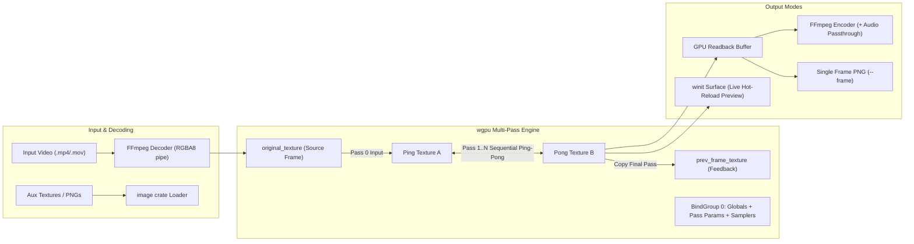

# ninja-shader 🥷🎬

> GPU-accelerated video shader processing pipeline & live previewer in **Rust** using **`wgpu`** and **FFmpeg**.

`ninja-shader` applies an arbitrary sequence of reusable GPU shaders (**WGSL** and **GLSL**) to video files with sub-millisecond per-frame GPU execution, audio passthrough, and a native hot-reloading preview window.

---

## Features

- **Multi-Pass Sequential GPU Pipeline**: Chain any number of reusable shaders in series via declarative TOML recipe files. Output of Pass $N$ feeds directly as input to Pass $N+1$.
- **Dual Language Support (WGSL + GLSL)**: Write shaders in modern WebGPU Shading Language (`.wgsl`) or Vulkan GLSL (`.glsl`). Both compile directly to native Metal on macOS.
- **Sidecar Manifests**: Every shader is defined by a `<name>.toml` manifest specifying metadata, typed parameters (`float`, `int`, `uint`, `vec2`, `vec3`, `vec4`, `color`), ranges, defaults, and auxiliary textures.
- **Temporal Feedback & Rich Context**: Shaders automatically receive `globals` (`time`, `delta_time`, `frame`, `fps`, `resolution`), `input_tex`, source video `original_tex`, and previous frame output `prev_frame_tex` for motion trails and feedback loops.
- **Audio Passthrough & FFmpeg Integration**: Seamlessly decodes and encodes H.264 video streams while preserving original audio streams.
- **Live Hot-Reload Preview Window**: Interactive native desktop window (`winit`) that plays video and hot-reloads shader files and parameter values instantly upon saving.
- **Library Management**: Built-in CLI commands to `list`, `inspect`, `validate`, and scaffold `new` shaders.

---

## Architecture



---

## Installation & Requirements

Ensure `ffmpeg` and `ffprobe` are installed on your system:

```bash
# macOS
brew install ffmpeg
```

Build the release binary:

```bash
cargo build --release
```

The compiled binary will be located at `./target/release/ninja-shader`.

---

## CLI Usage

### 1. Studio GUI (Live Previewer & Renderer)
Launch the native desktop studio interface:

```bash
ninja-shader gui
```

Or pre-populate an input video, output directory, or pipeline:

```bash
ninja-shader gui -i input.mp4 -o output/ -p pipelines/retro_crt.toml
```

**Studio GUI Features:**
- **File Picker**: Native macOS/OS open dialog to pick any video file (`mp4`, `mov`, `mkv`, `avi`, `webm`).
- **Output Directory**: Native OS directory picker to configure the output render directory.
- **Pipeline Browser**: Live searchable list of all 30+ pipeline recipes; clicking instantly hot-swaps shaders on the playing video.
- **Pass Parameter Sliders**: Tweak live shader uniform parameters (floats, ints, colors) and watch immediate visual results.
- **Background Rendering**: Render full videos with real-time animated progress bar, percentage, FPS, and cancellation support without freezing playback.
- **Playback Bar**: Play/pause, seek scrubber, restart, and loop controls.

### 2. Render Video Pipeline (CLI)

```bash
ninja-shader render --pipeline pipelines/retro_crt.toml -i input.mp4 -o output.mp4
```

CLI options:
- `--pipeline <PATH>`: Path to pipeline recipe TOML file
- `-i, --input <PATH>`: Override input video file
- `-o, --output <PATH>`: Override output video/image file
- `--frame <N>`: Render only frame index `N` (0-based) to PNG
- `--scale <FLOAT>`: Scale resolution (e.g. `0.5` for fast half-res preview renders)
- `--crf <INT>`: H.264 CRF quality factor (0-51, default `18`)
- `--start <SEC>`: Start offset in seconds
- `--duration <SEC>`: Duration in seconds to process

### 2. Live Hot-Reload Preview Window
Open the native desktop preview window to watch video playback and tune shaders live:

```bash
ninja-shader preview --pipeline pipelines/retro_crt.toml -i input.mp4
```

**Keyboard Controls in Preview Window:**
- `Space`: Pause / Resume playback
- `R`: Restart video from frame 0
- `S`: Save current processed frame as a timestamped PNG screenshot
- `Esc` / `Q`: Exit

> **Hot-Reloading**: Edit any parameter in `pipelines/retro_crt.toml` or any shader in `shaders/` and save the file. The preview window updates instantly without restarting playback.

### 3. List Available Shaders
```bash
ninja-shader list
```
Displays all discoverable WGSL and GLSL shaders in the library along with descriptions and configurable parameters.

### 4. Inspect Shader Details
```bash
ninja-shader inspect crt_scanlines
```
Prints language, parameters, types, ranges, defaults, and custom textures.

### 5. Scaffold a New Shader
```bash
ninja-shader new glitch --lang wgsl
# or for GLSL:
ninja-shader new neon --lang glsl
```
Creates `shaders/<name>.toml` and boilerplate `shaders/<name>.wgsl` (or `.glsl`).

### 6. Validate Pipeline Recipe
```bash
ninja-shader validate --pipeline pipelines/retro_crt.toml
```
Verifies all passes, parameters, and performs headless GPU shader compilation to ensure the recipe is ready for production rendering.

---

## Shader Library Contract (ABI)

Every fragment shader receives:

### Group 0 (Built-In Video Context)
- `@group(0) @binding(0) var<uniform> globals: Globals;`
  - `globals.resolution`: `vec2<f32>` (width, height in pixels)
  - `globals.inv_resolution`: `vec2<f32>` (1.0 / width, 1.0 / height)
  - `globals.time`: `f32` (elapsed seconds)
  - `globals.delta_time`: `f32` (1.0 / fps)
  - `globals.frame`: `u32` (current frame number)
  - `globals.fps`: `f32` (frame rate)
- `@group(0) @binding(1) var linear_sampler: sampler;`
- `@group(0) @binding(2) var nearest_sampler: sampler;`
- `@group(0) @binding(3) var input_tex: texture_2d<f32>;` (output of previous shader pass)
- `@group(0) @binding(4) var original_tex: texture_2d<f32>;` (unmodified source video frame)
- `@group(0) @binding(5) var prev_frame_tex: texture_2d<f32>;` (final output from frame $N-1$)

### Group 1 (Custom Shader Parameters & Auxiliary Textures)
- `@group(1) @binding(0) var<uniform> params: Params;` (dynamically packed uniform buffer)
- `@group(1) @binding(1..N)` (custom textures declared in `[[textures]]`)

*Note: Group 0 and Group 1 headers are auto-injected if not explicitly declared in your shader file.*

---

## Included Shader Library (28 Shaders)

### 1. Cyberpunk, Glitch & Datamosh
| Shader | Language | Features |
| :--- | :---: | :--- |
| `digital_glitch` | WGSL | Scan-band tearing, random slice displacement, and RGB chroma shifts |
| `datamosh` | WGSL | Macroblock motion-vector smearing and I-frame drop via `prev_frame_tex` |
| `pixel_sort` | WGSL | Directional luminance threshold pixel sorting and streak smearing |
| `rgb_wave` | WGSL | Sinusoidal and sawtooth horizontal wave distortion with phase-offset RGB |
| `block_corrupt` | WGSL | MPEG macroblock corruption with UV swapping, bit-crushing, and inversion |

### 2. Neon & Synthwave
| Shader | Language | Features |
| :--- | :---: | :--- |
| `bloom` | WGSL | Bright-pass extraction and dual-ring Gaussian glow diffusion |
| `neon_edge` | WGSL | 3x3 Sobel gradient edge detection rendered as pulsing neon contours |
| `synthwave_grid` | WGSL | Outrun perspective scrolling laser floor grid and horizon haze |
| `duotone_cyber` | WGSL | Cyberpunk split-toning mapping shadows & highlights across neon palettes |
| `halation` | WGSL | Red-orange film emulsion halation scatter around high-contrast edges |

### 3. Sci-Fi HUD & Hologram
| Shader | Language | Features |
| :--- | :---: | :--- |
| `hologram` | WGSL | Volumetric hologram with interference lines, rolling sync bar, and flicker |
| `night_vision` | WGSL | Tactical Gen-3 green phosphor goggles with IR amplification and tube mask |
| `thermal_infrared` | WGSL | FLIR false-color thermal heat imaging with ironbow gradients & isotherms |
| `radar_hud` | WGSL | Tactical visor HUD with rotating radar sweep, reticles, and corner framing |
| `vhs_tracking` | WGSL | Analog VHS tape tracking error bars, head-switching noise, and line jitter |

### 4. Cyber Stylization & Analog
| Shader | Language | Features |
| :--- | :---: | :--- |
| `ascii_matrix` | WGSL | Procedural cellular glyph quantization with falling digital rain trails |
| `pixelate` | WGSL | Aspect-aware pixel grid quantization with optional color bit-depth crushing |
| `halftone_cyber` | WGSL | Rotated CMYK / Neon LED dot-matrix halftone screen pattern |
| `kaleido_prism` | WGSL | Radial N-fold mirror symmetry prism distortion with continuous rotation |
| `vhs_chroma_bleed` | WGSL | YIQ/YUV luma-chroma separation with low-pass horizontal chrominance smearing |

### 5. Starter Utility & Cinema Shaders
| Shader | Language | Features |
| :--- | :---: | :--- |
| `grayscale` | WGSL | Rec. 709 luminance desaturation with `strength` parameter |
| `vignette` | WGSL | Radial edge vignette with `intensity`, `radius`, `softness`, and `tint` |
| `chromatic_aberration` | GLSL | RGB radial channel splitting driven by `amount` |
| `crt_scanlines` | WGSL | Barrel screen distortion, animated scanlines, and CRT bezel |
| `film_grain` | GLSL | Temporal hash-based film grain noise driven by frame & time |
| `motion_trails` | WGSL | Phosphor decay and ghosting using `prev_frame_tex` feedback |
| `texture_overlay` | WGSL | External image/pattern texture blending with `opacity` and `uv_scale` |
| `sepia` | WGSL | Warm vintage tint adjustment |

---

## Included Pipeline Recipes (32 Recipes)

`ninja-shader` includes 32 production-ready recipes in `pipelines/`:

1. `cyber_runner.toml` (5 passes: `duotone_cyber` → `halation` → `bloom` → `film_grain` → `vignette`)
2. `ghost_hologram.toml` (5 passes: `hologram` → `neon_edge` → `rgb_wave` → `bloom` → `crt_scanlines`)
3. `datamosh_breakdown.toml` (4 passes: `datamosh` → `block_corrupt` → `digital_glitch` → `chromatic_aberration`)
4. `synthwave_outrun.toml` (5 passes: `duotone_cyber` → `synthwave_grid` → `bloom` → `crt_scanlines` → `vignette`)
5. `matrix_terminal.toml` (5 passes: `ascii_matrix` → `bloom` → `crt_scanlines` → `motion_trails` → `vignette`)
6. `predator_thermal.toml` (4 passes: `thermal_infrared` → `radar_hud` → `crt_scanlines` → `chromatic_aberration`)
7. `tactical_nvg.toml` (5 passes: `night_vision` → `radar_hud` → `bloom` → `film_grain` → `vignette`)
8. `corrupted_vhs.toml` (5 passes: `vhs_chroma_bleed` → `vhs_tracking` → `rgb_wave` → `film_grain` → `vignette`)
9. `pixel_sort_meltdown.toml` (4 passes: `pixel_sort` → `duotone_cyber` → `bloom` → `chromatic_aberration`)
10. `neon_wireframe.toml` (4 passes: `neon_edge` → `bloom` → `motion_trails` → `vignette`)
11. `arcade_16bit.toml` (5 passes: `pixelate` → `duotone_cyber` → `crt_scanlines` → `bloom` → `vignette`)
12. `cyber_halftone_press.toml` (4 passes: `duotone_cyber` → `halftone_cyber` → `neon_edge` → `vignette`)
13. `kaleido_cyber_trip.toml` (5 passes: `kaleido_prism` → `duotone_cyber` → `neon_edge` → `bloom` → `chromatic_aberration`)
14. `drone_recon_hud.toml` (5 passes: `grayscale` → `neon_edge` → `radar_hud` → `vhs_tracking` → `crt_scanlines`)
15. `neural_overload.toml` (6 passes: `rgb_wave` → `pixel_sort` → `digital_glitch` → `neon_edge` → `bloom` → `vignette`)
16. `analog_broadcast_1984.toml` (5 passes: `vhs_chroma_bleed` → `crt_scanlines` → `halation` → `film_grain` → `vignette`)
17. `holodeck_malfunction.toml` (5 passes: `hologram` → `block_corrupt` → `digital_glitch` → `synthwave_grid` → `bloom`)
18. `infrared_sat_link.toml` (5 passes: `thermal_infrared` → `pixelate` → `radar_hud` → `vhs_tracking` → `vignette`)
19. `cyber_noir_rain.toml` (5 passes: `grayscale` → `halation` → `ascii_matrix` → `bloom` → `vignette`)
20. `glitch_art_gallery.toml` (4 passes: `pixel_sort` → `block_corrupt` → `rgb_wave` → `halftone_cyber`)
21. `vhs_cyber_dub.toml` (5 passes: `duotone_cyber` → `vhs_chroma_bleed` → `vhs_tracking` → `motion_trails` → `crt_scanlines`)
22. `laser_grid_visor.toml` (5 passes: `synthwave_grid` → `neon_edge` → `radar_hud` → `bloom` → `chromatic_aberration`)
23. `deep_net_dive.toml` (5 passes: `ascii_matrix` → `kaleido_prism` → `neon_edge` → `bloom` → `motion_trails`)
24. `security_cam_hack.toml` (5 passes: `night_vision` → `digital_glitch` → `vhs_tracking` → `pixelate` → `crt_scanlines`)
25. `chroma_prism_dream.toml` (5 passes: `kaleido_prism` → `halation` → `bloom` → `chromatic_aberration` → `motion_trails`)
26. `signal_jammed.toml` (5 passes: `rgb_wave` → `vhs_tracking` → `block_corrupt` → `digital_glitch` → `film_grain`)
27. `neon_halftone_arcade.toml` (5 passes: `pixelate` → `halftone_cyber` → `neon_edge` → `bloom` → `crt_scanlines`)
28. `bio_scanner_xray.toml` (5 passes: `grayscale` → `neon_edge` → `hologram` → `radar_hud` → `bloom`)
29. `temporal_datamosh_echo.toml` (5 passes: `datamosh` → `motion_trails` → `duotone_cyber` → `halation` → `vignette`)
30. `ultimate_cyberpunk.toml` (6 passes: `duotone_cyber` → `neon_edge` → `hologram` → `digital_glitch` → `bloom` → `vignette`)
31. `retro_crt.toml` (5 passes: `chromatic_aberration` → `crt_scanlines` → `motion_trails` → `film_grain` → `vignette`)
32. `noir_film.toml` (4 passes: `grayscale` → `texture_overlay` → `film_grain` → `vignette`)

---

---

## Example Pipeline Recipe (`pipelines/retro_crt.toml`)

```toml
name = "retro_crt"
description = "Vintage CRT TV look"
input = "test_input.mp4"
output = "output_retro_crt.mp4"

[settings]
scale = 1.0
crf = 18
preset = "medium"
copy_audio = true

[[passes]]
shader = "chromatic_aberration"
enabled = true
[passes.params]
amount = 0.006

[[passes]]
shader = "crt_scanlines"
enabled = true
[passes.params]
curvature = 0.12
scanline_intensity = 0.30
scanline_count = 360.0

[[passes]]
shader = "motion_trails"
enabled = true
[passes.params]
decay = 0.35

[[passes]]
shader = "film_grain"
enabled = true
[passes.params]
intensity = 0.06
size = 1.0

[[passes]]
shader = "vignette"
enabled = true
[passes.params]
intensity = 0.80
radius = 0.75
softness = 0.40
tint = [0.0, 0.0, 0.0]
```
