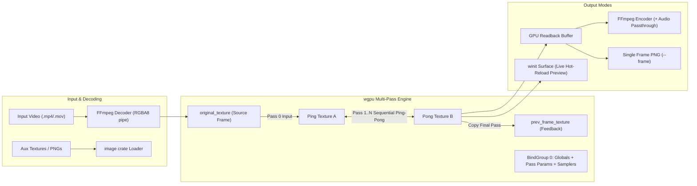

# ninja-shader 🥷🎬

> GPU-accelerated video shader processing pipeline & live previewer in **Rust** using **`wgpu`** and **FFmpeg**.

`ninja-shader` applies an arbitrary sequence of reusable GPU shaders (**WGSL** and **GLSL**) to video files with sub-millisecond per-frame GPU execution, audio passthrough, and a native hot-reloading preview window.

---

## Features

- **Multi-Pass Sequential GPU Pipeline**: Chain any number of reusable shaders in series via declarative TOML recipe files. Output of Pass $N$ feeds directly as input to Pass $N+1$.
- **Dual Language Support (WGSL + GLSL)**: Write shaders in modern WebGPU Shading Language (`.wgsl`) or Vulkan GLSL (`.glsl`). Both compile directly to native Metal on macOS.
- **Sidecar Manifests**: Every shader is defined by a `<name>.toml` manifest specifying metadata, typed parameters (`float`, `int`, `uint`, `vec2`, `vec3`, `vec4`, `color`), ranges, defaults, and auxiliary textures.
- **Temporal Feedback & Rich Context**: Shaders automatically receive `globals` (`time`, `delta_time`, `frame`, `fps`, `resolution`), `input_tex`, source video `original_tex`, and previous frame output `prev_frame_tex` for motion trails and feedback loops.
- **Audio Passthrough & FFmpeg Integration**: Seamlessly decodes and encodes H.264 video streams while preserving original audio streams.
- **Live Hot-Reload Preview Window**: Interactive native desktop window (`winit`) that plays video and hot-reloads shader files and parameter values instantly upon saving.
- **Library Management**: Built-in CLI commands to `list`, `inspect`, `validate`, and scaffold `new` shaders.

---

## Architecture



---

## Installation & Requirements

Ensure `ffmpeg` and `ffprobe` are installed on your system:

```bash
# macOS
brew install ffmpeg
```

Build the release binary:

```bash
cargo build --release
```

The compiled binary will be located at `./target/release/ninja-shader`.

---

## CLI Usage

### 1. Render Video Pipeline
Process an entire video file through a pipeline recipe:

```bash
ninja-shader render --pipeline pipelines/retro_crt.toml -i input.mp4 -o output.mp4
```

CLI options:
- `--pipeline <PATH>`: Path to pipeline recipe TOML file
- `-i, --input <PATH>`: Override input video file
- `-o, --output <PATH>`: Override output video/image file
- `--frame <N>`: Render only frame index `N` (0-based) to PNG
- `--scale <FLOAT>`: Scale resolution (e.g. `0.5` for fast half-res preview renders)
- `--crf <INT>`: H.264 CRF quality factor (0-51, default `18`)
- `--start <SEC>`: Start offset in seconds
- `--duration <SEC>`: Duration in seconds to process

### 2. Live Hot-Reload Preview Window
Open the native desktop preview window to watch video playback and tune shaders live:

```bash
ninja-shader preview --pipeline pipelines/retro_crt.toml -i input.mp4
```

**Keyboard Controls in Preview Window:**
- `Space`: Pause / Resume playback
- `R`: Restart video from frame 0
- `S`: Save current processed frame as a timestamped PNG screenshot
- `Esc` / `Q`: Exit

> **Hot-Reloading**: Edit any parameter in `pipelines/retro_crt.toml` or any shader in `shaders/` and save the file. The preview window updates instantly without restarting playback.

### 3. List Available Shaders
```bash
ninja-shader list
```
Displays all discoverable WGSL and GLSL shaders in the library along with descriptions and configurable parameters.

### 4. Inspect Shader Details
```bash
ninja-shader inspect crt_scanlines
```
Prints language, parameters, types, ranges, defaults, and custom textures.

### 5. Scaffold a New Shader
```bash
ninja-shader new glitch --lang wgsl
# or for GLSL:
ninja-shader new neon --lang glsl
```
Creates `shaders/<name>.toml` and boilerplate `shaders/<name>.wgsl` (or `.glsl`).

### 6. Validate Pipeline Recipe
```bash
ninja-shader validate --pipeline pipelines/retro_crt.toml
```
Verifies all passes, parameters, and performs headless GPU shader compilation to ensure the recipe is ready for production rendering.

---

## Shader Library Contract (ABI)

Every fragment shader receives:

### Group 0 (Built-In Video Context)
- `@group(0) @binding(0) var<uniform> globals: Globals;`
  - `globals.resolution`: `vec2<f32>` (width, height in pixels)
  - `globals.inv_resolution`: `vec2<f32>` (1.0 / width, 1.0 / height)
  - `globals.time`: `f32` (elapsed seconds)
  - `globals.delta_time`: `f32` (1.0 / fps)
  - `globals.frame`: `u32` (current frame number)
  - `globals.fps`: `f32` (frame rate)
- `@group(0) @binding(1) var linear_sampler: sampler;`
- `@group(0) @binding(2) var nearest_sampler: sampler;`
- `@group(0) @binding(3) var input_tex: texture_2d<f32>;` (output of previous shader pass)
- `@group(0) @binding(4) var original_tex: texture_2d<f32>;` (unmodified source video frame)
- `@group(0) @binding(5) var prev_frame_tex: texture_2d<f32>;` (final output from frame $N-1$)

### Group 1 (Custom Shader Parameters & Auxiliary Textures)
- `@group(1) @binding(0) var<uniform> params: Params;` (dynamically packed uniform buffer)
- `@group(1) @binding(1..N)` (custom textures declared in `[[textures]]`)

*Note: Group 0 and Group 1 headers are auto-injected if not explicitly declared in your shader file.*

---

## Included Starter Shaders

| Shader | Language | Features |
| :--- | :---: | :--- |
| `grayscale` | WGSL | Rec. 709 luminance desaturation with `strength` parameter |
| `vignette` | WGSL | Radial edge vignette with `intensity`, `radius`, `softness`, and `tint` |
| `chromatic_aberration` | GLSL | RGB radial channel splitting driven by `amount` |
| `crt_scanlines` | WGSL | Barrel screen distortion, animated scanlines, and CRT bezel |
| `film_grain` | GLSL | Temporal hash-based film grain noise driven by frame & time |
| `motion_trails` | WGSL | Phosphor decay and ghosting using `prev_frame_tex` feedback |
| `texture_overlay` | WGSL | External image/pattern texture blending with `opacity` and `uv_scale` |
| `sepia` | WGSL | Warm vintage tint adjustment |

---

## Example Pipeline Recipe (`pipelines/retro_crt.toml`)

```toml
name = "retro_crt"
description = "Vintage CRT TV look"
input = "test_input.mp4"
output = "output_retro_crt.mp4"

[settings]
scale = 1.0
crf = 18
preset = "medium"
copy_audio = true

[[passes]]
shader = "chromatic_aberration"
enabled = true
[passes.params]
amount = 0.006

[[passes]]
shader = "crt_scanlines"
enabled = true
[passes.params]
curvature = 0.12
scanline_intensity = 0.30
scanline_count = 360.0

[[passes]]
shader = "motion_trails"
enabled = true
[passes.params]
decay = 0.35

[[passes]]
shader = "film_grain"
enabled = true
[passes.params]
intensity = 0.06
size = 1.0

[[passes]]
shader = "vignette"
enabled = true
[passes.params]
intensity = 0.80
radius = 0.75
softness = 0.40
tint = [0.0, 0.0, 0.0]
```
